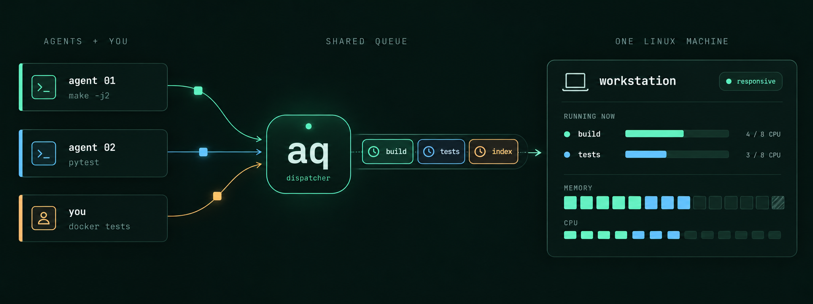

[English](README.md) · Русский

# aq — место для тяжёлых задач



В одном терминале идут тесты, в другом — сборка, а рядом работают несколько
кодинг-агентов. Память и процессоры у них общие. Если каждый запустит тяжёлую
команду сразу, рабочая машина может перестать нормально отвечать.

**aq даёт этим командам общую очередь и лимиты ресурсов.** Вы задаёте бюджет
памяти, число CPU и максимальное время работы. aq запускает задачу, когда для
неё хватает ресурсов, сохраняет вывод и позволяет вернуться за результатом позже.

Это локальная Linux-утилита для людей и агентов, работающих под одной учётной
записью. CLI, фоновый сервис и MCP-сервер входят в один бинарник.

## Что умеет aq

- **Ставит задачи в очередь**, когда пул ресурсов занят.
- **Ограничивает каждую задачу:** память, процессорное время и длительность контролируют systemd и cgroup v2.
- **Учится на прошлых запусках:** для именованных задач можно оценивать память и время по истории.
- **Учитывает контейнеры:** резервы выделяют ресурсы для Docker-окружения вместе с тестами.
- **Сохраняет результаты:** логи, причины завершения, пик памяти и статистику очереди.
- **Бережёт SSD:** временные файлы задач живут в RAM и считаются памятью задачи, а каждая задача записывает, сколько она записала на диск, так что тесты, изнашивающие диск, видны в `aq stats`.
- **Работает с агентами:** в комплекте есть skills для Claude Code и Codex, опциональные хуки и доставка уведомлений.

Если ресурсов хватает, задачи работают параллельно. aq помогает сдерживать
перерасход ресурсов, но не гарантирует, что память на машине никогда не закончится.
Контейнеры, запущенные через Docker, находятся вне лимитов задачи: для них нужен резерв.

## Первый запуск

Нужны **Linux, systemd 254 или новее и cgroup v2** с делегированными пользователю
контроллерами `memory`, `cpu` и `pids`. Для сборки — **Go 1.26** и
[just](https://github.com/casey/just). Поддержки macOS и Windows пока нет.

В каталоге клонированного репозитория подготовьте конфигурацию:

```sh
mkdir -p ~/.config/agent-queue
# Копируем пример, только если конфигурации ещё нет.
test -e ~/.config/agent-queue/config.toml || \
  cp deploy/config.example.toml ~/.config/agent-queue/config.toml
```

Перед установкой откройте этот файл и подберите `pool_memory` и `pool_cpus`
для своей машины. По умолчанию это **16 ГиБ и 16 CPU**. Память должна оставлять
хосту настроенный резерв — по умолчанию 10%, а число CPU не должно превышать
доступное на машине. Если нужны ресурсы для другой работы, уменьшите пул.

По желанию делегируйте пользователю ещё и контроллер `io`: тогда aq будет
записывать, сколько каждая задача записала на диск ([как](docs/guide.ru.md#запись-на-диск)).
Без него задачи работают как обычно, просто без цифр по диску.

```sh
just install
export PATH="$HOME/.local/bin:$PATH"
aq doctor
```

Установка запускает пользовательский сервис и устанавливает skills для агентов.
Существующая конфигурация сохраняется; хуки подключаются отдельно. Другие пути
установки, обновление, работа после выхода из сессии и удаление описаны в
[руководстве](docs/guide.ru.md#установка).

Начните с небольшой задачи без зависимостей проекта:

```sh
id=$(aq submit --memory 64M --cpus 1 --timeout 1m -- /usr/bin/printf 'Hello from aq!\n')
aq wait "$id"
aq logs "$id"
```

`submit` сразу возвращает ID. `wait` дожидается результата и при успехе выходит
с кодом 0. `logs` показывает сохранённый вывод. Теперь можно попробовать сборку
из рабочего каталога своего проекта, подобрав подходящие лимиты:

```sh
id=$(aq submit --name build --memory 4G --cpus 2 --timeout 30m -- make -j2)
aq status "$id"
aq wait "$id"
aq logs "$id" --tail 50
```

Команда запускается без неявной оболочки. Квота CPU ограничивает процессорное
время, но не выбирает число работников сборки: его нужно задать отдельно, как
`-j2` в примере. Про shell и `$AQ_CPUS` — в разделе [запуска задач](docs/guide.ru.md#запуск-задач).

## Команды на каждый день

| Что нужно | Команда |
|---|---|
| Посмотреть задачи и причины ожидания | `aq list` |
| Узнать состояние задачи | `aq status ID` |
| Прочитать вывод | `aq logs ID --tail 50` |
| Остановить задачу | `aq cancel ID` |
| Посмотреть состояние машины и пула | `aq top` |
| Посмотреть память, своп и простой каждой сессии агентов | `aq top --sessions` |
| Посмотреть последнюю инвентаризацию /tmp (только чтение) | `aq tmp [--json] [--rescan]` |
| Данные для панели или статус-бара (JSON) | `aq dashboard` |
| Собрать статистику за неделю | `aq stats --since 7d` |
| Узнать, кто писал на диск, по источникам | `aq stats disk` |
| Найти резервы, которые держат память и не используют её | `aq stats reservations` |
| Узнать параметры команды | `aq help COMMAND` |

Для программного чтения используйте `--json` у команд просмотра. Если задача
упала, начните с `aq status ID` и `aq logs ID --stream stderr`. В руководстве
есть [коды завершения](docs/guide.ru.md#наблюдение-и-ожидание) и
[разбор ошибок памяти](docs/guide.ru.md#oom-и-другие-сбои).

## Работа с кодинг-агентами

`just install` устанавливает отдельные skills для Claude Code и Codex. Они
объясняют агенту, когда поставить команду в очередь, когда зарезервировать
ресурсы под контейнеры и как получить результат. Опциональные хуки напоминают
о тяжёлых командах вне aq, но не блокируют их.

Настройте [уведомления](docs/guide.ru.md#уведомления); при необходимости подключите
[MCP](docs/guide.ru.md#mcp) и [хуки](docs/guide.ru.md#хук).
Перезапуск демона сохраняет работающие задачи, а `aq wait` переподключается сам.

## Почему aq заботится о SSD

На моей рабочей машине десяток кодинг-агентов, круглосуточно гонявших полные
наборы тестов, записали на NVMe **1.2 TB за пять часов**. Диск показывал износ
16% после 28 TB записанного: при таком темпе он выработал бы ресурс примерно за
месяц.

Самих данных было немного. Диск изнашивали **мелкие принудительные записи**:
каждый `fsync` и каждое создание или удаление файла заставляют файловую систему
сразу записать данные и журнал, а не копить их в памяти. В тестах и того и
другого много: тестовые базы с `fsync` на каждый коммит, сброс базы перед каждым
тестом, временные каталоги `pytest` на десятки тысяч файлов за прогон. Человек,
который запускает тесты несколько раз в день, этого не заметит. Много агентов,
параллельно перезапускающих всё подряд, превращают рабочую машину в CI-ферму на
домашнем железе.

Поэтому aq теперь:

- выдаёт каждой задаче отдельный временный каталог в RAM (в `/tmp`, если это
  tmpfs), где `fsync` ничего не стоит, и удаляет его после задачи. Эти страницы
  считаются памятью задачи (`--memory`), а переполненный `/tmp` придерживает
  очередь вместо падающих тестов
  ([подробнее](docs/guide.ru.md#временные-файлы-живут-в-ram-и-считаются-памятью-задачи));
- записывает, сколько каждая задача записала на диск, и показывает главных
  «писателей» в `aq stats` ([подробнее](docs/guide.ru.md#запись-на-диск));
- показывает, сколько записал на диск весь хост и по каким источникам (aq,
  проекты docker, системные службы, сессии агентов), и присылает уведомление
  при сильной записи, пока её ещё можно остановить.

Если на одной машине работает много агентов, стоит ещё: держать `TMPDIR` и
`--basetemp` pytest в tmpfs, а не переносить их на диск, когда `/tmp`
заполняется (лучше поднять лимит inode у tmpfs); запускать тестовые базы с
`fsync=off` (PostgreSQL) или `PRAGMA synchronous=OFF` (SQLite); время от времени
проверять износ диска через `smartctl -A`.

## Результаты на рабочей машине

Шесть дней обычной работы, с 28 октября по 3 ноября 2026 года, на той же
машине, что и в истории про SSD: Intel Core i9-13900H (14 ядер, 20 потоков),
31 GiB памяти и 8 GiB zram-свопа, NVMe на 1 ТБ, Fedora с Linux 7.1. Настройки
aq: `pool_memory = "27G"`, `pool_cpus = 16`, резерв памяти 10%, backfill
включён. Сессии Claude Code и Codex работали в 62 каталогах проектов: тесты на
Python, Go и Flutter, стенды Docker Compose с браузерными тестами, сборки
образов и данных. Цифры взяты из `aq stats`, журнала ядра и счётчиков
ввода-вывода ядра.

| Что измеряли | Результат |
|---|---|
| Нагрузка | 1061 задача (581 от Claude Code, 476 от Codex) и 263 резерва; 653 задачи шли внутри резерва. Одновременно было активно не больше 8 заданий (задач и резервов); всего задачи работали 79 часов. |
| Итоги | 617 задач успешны, 362 упали сами (в основном упавшие тесты). 30 отменены, 5 упёрлись в таймаут. 32 отклонены при отправке, в основном вторая вложенная задача, отправленная, пока бюджет задач резерва был занят. |
| Убиты из-за памяти | 7 задач на своём лимите `--memory`, 7 защитником хоста, когда машине не хватило памяти. |
| Ожидание в очереди | Задачи, прошедшие через очередь: медиана 2 мс, 90-й перцентиль 42 мс; 27 из 393 ждали больше минуты, дольше всех 52 минуты. Резервы: медиана 5 мс, 90-й перцентиль 3,5 минуты. Всего в очереди что-то ждало 8,8 часа, в основном потому, что свободной памяти не хватало самому хосту, а не пулу. |
| Память | Задачи aq занимали одновременно до 10,3 GiB. Доступная память хоста опускалась до 3,5 GiB (в среднем 17,5 GiB), zram-своп заполнялся целиком. Давление на память дважды закрывало допуск, всего на 2 минуты 20 секунд. |
| OOM хоста | В журнале ядра нет ни одного OOM-убийства на уровне всего хоста: каждое упиралось в лимит cgroup (задачи aq, контейнеры docker, собственные тесты aq). |
| Запись на диск | Задачи aq записали на диск 63 GiB: медианный прогон 0,14 MiB, а один мобильный тестовый набор записал 47 GiB за один прогон. Всего диск принял за период 3,0 TiB, около 20 ГБ в час, и задачи aq записали из этого около 2%. Остальное пришлось на то, что aq не измеряет: команды, которые агенты запускали сами (одна долгая сессия агента записала около 1 TiB), контейнеры docker, в том числе зарезервированных стендов, и системный журнал. |
| Подсказки агентам | Опциональный хук 259 раз напомнил агентам, что они запускают тяжёлое вне aq: 149 раз в худший день, к концу недели около 10 в день. |
| Сопоставимый запуск без aq | Не измеряли. До aq диск принимал 1,2 ТБ за пять часов (около 240 ГБ в час). Нагрузка была другой, а часть тестовых баз в те же недели переехала в tmpfs с `fsync=off`, так что эти цифры не контролируемое сравнение. |

Итого: ни одного OOM-убийства на уровне хоста, и у каждого задания записан
итог. Работу, которую агенты запускают в обход aq, он не достаёт, и большая
часть износа диска за этот период пришлась на неё.

`aq stats --since 7d` и `aq stats export --since 7d --format jsonl` дают те же
цифры для вашей машины.

## Дальше

- [Руководство пользователя](docs/guide.ru.md): установка, профили, резервы, уведомления, диагностика и хранение данных.
- [Пример конфигурации](deploy/config.example.toml): параметры и значения по умолчанию.
- [Архитектура](docs/architecture.md): планирование, изоляция, восстановление и известные ограничения; на английском.
- [Участие в разработке](CONTRIBUTING.md): окружение, тесты и сообщения об ошибках; на английском.

Исправления и улучшения документации приветствуются. Лицензия — [MIT](LICENSE).
