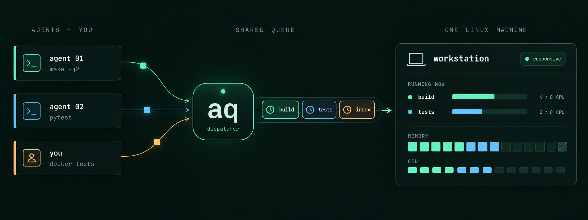

[English](README.md) · Русский

# aq — место для тяжёлых задач



В одном терминале идут тесты, в другом — сборка, а рядом работают несколько
кодинг-агентов. Память и процессоры у них общие. Если каждый запустит тяжёлую
команду сразу, рабочая машина может перестать нормально отвечать.

**aq даёт этим командам общую очередь и лимиты ресурсов.** Вы задаёте бюджет
памяти, число CPU и максимальное время работы. aq запускает задачу, когда для
неё хватает ресурсов, сохраняет вывод и позволяет вернуться за результатом позже.

Это локальная Linux-утилита для людей и агентов, работающих под одной учётной
записью. CLI, фоновый сервис и MCP-сервер входят в один бинарник.

## Что умеет aq

- **Ставит задачи в очередь**, когда пул ресурсов занят.
- **Ограничивает каждую задачу:** память, процессорное время и длительность контролируют systemd и cgroup v2.
- **Учится на прошлых запусках:** для именованных задач можно оценивать память и время по истории.
- **Учитывает контейнеры:** резервы выделяют ресурсы для Docker-окружения вместе с тестами.
- **Сохраняет результаты:** логи, причины завершения, пик памяти и статистику очереди.
- **Бережёт SSD:** временные файлы задач живут в RAM и считаются памятью задачи, а каждая задача записывает, сколько она записала на диск, так что тесты, изнашивающие диск, видны в `aq stats`.
- **Работает с агентами:** в комплекте есть skills для Claude Code и Codex, опциональные хуки и доставка уведомлений.

Если ресурсов хватает, задачи работают параллельно. aq помогает сдерживать
перерасход ресурсов, но не гарантирует, что память на машине никогда не закончится.
Контейнеры, запущенные через Docker, находятся вне лимитов задачи: для них нужен резерв.

## Первый запуск

Нужны **Linux, systemd 254 или новее и cgroup v2** с делегированными пользователю
контроллерами `memory`, `cpu` и `pids`. Для сборки — **Go 1.26** и
[just](https://github.com/casey/just). Поддержки macOS и Windows пока нет.

В каталоге клонированного репозитория подготовьте конфигурацию:

```sh
mkdir -p ~/.config/agent-queue
# Копируем пример, только если конфигурации ещё нет.
test -e ~/.config/agent-queue/config.toml || \
  cp deploy/config.example.toml ~/.config/agent-queue/config.toml
```

Перед установкой откройте этот файл и подберите `pool_memory` и `pool_cpus`
для своей машины. По умолчанию это **16 ГиБ и 16 CPU**. Память должна оставлять
хосту настроенный резерв — по умолчанию 10%, а число CPU не должно превышать
доступное на машине. Если нужны ресурсы для другой работы, уменьшите пул.

По желанию делегируйте пользователю ещё и контроллер `io`: тогда aq будет
записывать, сколько каждая задача записала на диск ([как](docs/guide.ru.md#запись-на-диск)).
Без него задачи работают как обычно, просто без цифр по диску.

```sh
just install
export PATH="$HOME/.local/bin:$PATH"
aq doctor
```

Установка запускает пользовательский сервис и устанавливает skills для агентов.
Существующая конфигурация сохраняется; хуки подключаются отдельно. Другие пути
установки, обновление, работа после выхода из сессии и удаление описаны в
[руководстве](docs/guide.ru.md#установка).

Начните с небольшой задачи без зависимостей проекта:

```sh
id=$(aq submit --memory 64M --cpus 1 --timeout 1m -- /usr/bin/printf 'Hello from aq!\n')
aq wait "$id"
aq logs "$id"
```

`submit` сразу возвращает ID. `wait` дожидается результата и при успехе выходит
с кодом 0. `logs` показывает сохранённый вывод. Теперь можно попробовать сборку
из рабочего каталога своего проекта, подобрав подходящие лимиты:

```sh
id=$(aq submit --name build --memory 4G --cpus 2 --timeout 30m -- make -j2)
aq status "$id"
aq wait "$id"
aq logs "$id" --tail 50
```

Команда запускается без неявной оболочки. Квота CPU ограничивает процессорное
время, но не выбирает число работников сборки: его нужно задать отдельно, как
`-j2` в примере. Про shell и `$AQ_CPUS` — в разделе [запуска задач](docs/guide.ru.md#запуск-задач).

## Команды на каждый день

| Что нужно | Команда |
|---|---|
| Посмотреть задачи и причины ожидания | `aq list` |
| Узнать состояние задачи | `aq status ID` |
| Прочитать вывод | `aq logs ID --tail 50` |
| Остановить задачу | `aq cancel ID` |
| Посмотреть состояние машины и пула | `aq top` |
| Собрать статистику за неделю | `aq stats --since 7d` |
| Найти задачи, которые больше всех пишут на диск | `aq stats --since 1d` (раздел «Disk writes») |
| Узнать параметры команды | `aq help COMMAND` |

Для программного чтения используйте `--json` у команд просмотра. Если задача
упала, начните с `aq status ID` и `aq logs ID --stream stderr`. В руководстве
есть [коды завершения](docs/guide.ru.md#наблюдение-и-ожидание) и
[разбор ошибок памяти](docs/guide.ru.md#oom-и-другие-сбои).

## Работа с кодинг-агентами

`just install` устанавливает отдельные skills для Claude Code и Codex. Они
объясняют агенту, когда поставить команду в очередь, когда зарезервировать
ресурсы под контейнеры и как получить результат. Опциональные хуки напоминают
о тяжёлых командах вне aq, но не блокируют их.

Настройте [уведомления](docs/guide.ru.md#уведомления); при необходимости подключите
[MCP](docs/guide.ru.md#mcp) и [хуки](docs/guide.ru.md#хук).
Перезапуск демона сохраняет работающие задачи, а `aq wait` переподключается сам.

## Почему aq заботится о SSD

На моей рабочей машине десяток кодинг-агентов, круглосуточно гонявших полные
наборы тестов, записали на NVMe **1.2 TB за пять часов**. Диск показывал износ
16% после 28 TB записанного: при таком темпе он выработал бы ресурс примерно за
месяц.

Самих данных было немного. Диск изнашивали **мелкие принудительные записи**:
каждый `fsync` и каждое создание или удаление файла заставляют файловую систему
сразу записать данные и журнал, а не копить их в памяти. В тестах и того и
другого много: тестовые базы с `fsync` на каждый коммит, сброс базы перед каждым
тестом, временные каталоги `pytest` на десятки тысяч файлов за прогон. Человек,
который запускает тесты несколько раз в день, этого не заметит. Много агентов,
параллельно перезапускающих всё подряд, превращают рабочую машину в CI-ферму на
домашнем железе.

Поэтому aq теперь:

- выдаёт каждой задаче отдельный временный каталог в RAM (в `/tmp`, если это
  tmpfs), где `fsync` ничего не стоит, и удаляет его после задачи. Эти страницы
  считаются памятью задачи (`--memory`), а переполненный `/tmp` придерживает
  очередь вместо падающих тестов
  ([подробнее](docs/guide.ru.md#временные-файлы-живут-в-ram-и-считаются-памятью-задачи));
- записывает, сколько каждая задача записала на диск, и показывает главных
  «писателей» в `aq stats` ([подробнее](docs/guide.ru.md#запись-на-диск)).

Если на одной машине работает много агентов, стоит ещё: держать `TMPDIR` и
`--basetemp` pytest в tmpfs, а не переносить их на диск, когда `/tmp`
заполняется (лучше поднять лимит inode у tmpfs); запускать тестовые базы с
`fsync=off` (PostgreSQL) или `PRAGMA synchronous=OFF` (SQLite); время от времени
проверять износ диска через `smartctl -A`.

## Результаты на рабочей машине

**To be added — замеры ещё не собраны.**

Здесь появятся характеристики машины, описание нагрузки, настройки aq и период
измерений вместе с результатами. Пока численных обещаний производительности нет.

| Что измеряем | Результат |
|---|---|
| Нагрузка, число задач и параллельных агентов | To be added |
| Успешные, упавшие и отменённые задачи | To be added |
| Ожидание в очереди и общее время выполнения | To be added |
| Пик памяти и эпизоды нехватки памяти на хосте | To be added |
| Сопоставимый запуск без aq | To be added |

`aq stats --since 7d` и `aq stats export --since 7d --format jsonl` помогут
собрать данные для этого раздела. Для сравнения без aq нужен отдельный запуск.

## Дальше

- [Руководство пользователя](docs/guide.ru.md): установка, профили, резервы, уведомления, диагностика и хранение данных.
- [Пример конфигурации](deploy/config.example.toml): параметры и значения по умолчанию.
- [Архитектура](docs/architecture.md): планирование, изоляция, восстановление и известные ограничения; на английском.
- [Участие в разработке](CONTRIBUTING.md): окружение, тесты и сообщения об ошибках; на английском.

Исправления и улучшения документации приветствуются. Лицензия — [MIT](LICENSE).
