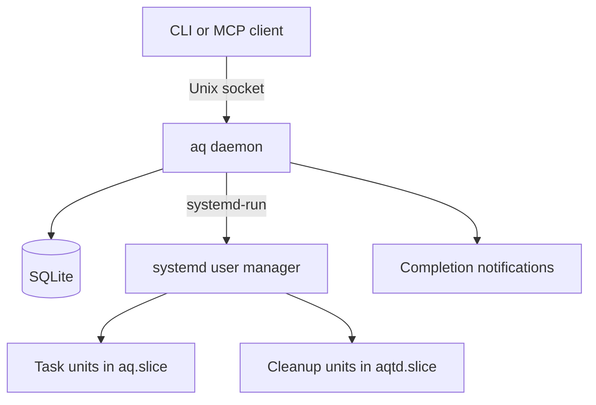

# How aq works

Aq coordinates heavy work on one Linux machine. This page explains what happens
between submitting a command and collecting its result, and where to look if
you want to change that behavior. For commands and setup, use the
[user guide](guide.md).

## Why there is a daemon

Imagine three agents checking available memory at the same moment. Each sees
8 GiB free and starts a 4 GiB job. Their individual checks were reasonable,
but together they promised more memory than the machine had.

Aq puts that decision in one place. Its daemon checks available resources and
reserves them under a scheduler lock. Other submissions see the updated total.
The queue handles waiting; Linux enforces the limits once a job starts.

This assumes cooperative clients under one Unix account. Aq cannot stop another
process with the same permissions from starting work outside the queue.

## The pieces

One Go binary supplies the command-line client, daemon, and MCP server.
The daemon runs as the user service `aq.service`. Clients reach it through a
private Unix socket; the server checks that they belong to the same Unix user.
SQLite stores tasks, reservations, results, profile history, and notification events.

The daemon lives outside the task pool. Each running task has its own systemd
service, so restarting the daemon does not stop the task. Cleanup scripts also
have a separate slice: freeing resources must remain possible when the task
pool is full.

The default locations are:

| What | Location |
|---|---|
| Configuration | `~/.config/agent-queue/config.toml` |
| Database and job files | `~/.local/state/agent-queue/` |
| Client socket | `$XDG_RUNTIME_DIR/agent-queue/aq.sock` |

`AQ_CONFIG`, `AQ_STATE_DIR`, and `AQ_RUNTIME_DIR` override these locations.
Startup locks prevent two daemons from managing the same runtime directory or slice.

## Follow a task

1. **Submit.** The client validates the command, captures selected environment
   variables, and sends the request. The daemon records the task and returns its ID.
2. **Wait for room.** The scheduler checks the pool and the live state of the host.
   A task that cannot start stays queued with a reason visible in `aq status`.
3. **Start with limits.** The daemon asks systemd to create a transient service.
   It sets the memory limit, disables task swap, applies a CPU quota, and sets a
   runtime timeout. It checks the applied memory limit after launch; a mismatch
   stops the unit and produces `LAUNCH_FAILED`.
4. **Run and capture output.** The internal runner starts the command in its
   working directory, provides a private temporary directory, and saves stdout
   and stderr. Each log stream has a size cap; excess output is drained and
   discarded. The temporary directory is `<tmp_dir or /tmp>/aq-<uid>-<slice>/<id>` when
   that filesystem is tmpfs or `tmp_dir` is set, so temp files cost task memory
   (tmpfs pages are charged to the unit's cgroup) instead of SSD writes and
   filesystem-journal churn; otherwise it falls back to the state dir. The daemon
   resolves the root once at start and refuses a symlinked or foreign-owned
   `aq-<uid>-<slice>` in a shared `/tmp`.
5. **Record the result.** The unit's `ExecStopPost` action writes `result.json`,
   including systemd's outcome and cgroup memory measurements. This works even
   while the daemon is down. With the `io` controller delegated (units and the
   slice set `IOAccounting=yes`), it also sums the unit's `io.stat` over physical
   disks only: a device without a `/sys/dev/block/M:m/device` link (dm, md,
   loop, zram) either forwards the same bytes to a physical disk or never
   reaches one. Without the controller the bytes are recorded as unknown (NULL),
   not zero, and nothing else changes. After recording, the same action deletes
   the task's temporary directory, so tmpfs pages never outlive the task outside
   any accounting.
6. **Release resources.** The scheduler waits for the cgroup to become empty
   before finalizing the task and returning its resources to the pool.

Commands are argument arrays, with no implicit shell or variable expansion.
The runner receives `AQ_CPUS` and `AQ_JOB_ID`, along with the captured environment.
Cancellation stops the whole cgroup: SIGTERM first, then SIGKILL after the grace
period. Background descendants do not escape cleanup just by detaching.

Failure reasons distinguish a command error, timeout, launch failure, missing
result, and memory kill. Exit code 137 alone is not evidence of an OOM; aq uses
systemd and cgroup information to classify the outcome.

## How the scheduler decides what fits

A task has two memory values:

- **Limit:** the most memory its cgroup may use.
- **Expected:** the amount reserved when deciding whether it can start.

By default they are equal. A profile or explicit `--expected` can make the
expected amount smaller. For example, a job that usually uses 1 GiB may need a
2 GiB ceiling for short peaks. Accounting for its usual use allows more work
to run, but simultaneous peaks can still cause a task to be killed.

The scheduler checks these blockers in order:

| Blocker | Why the task waits |
|---|---|
| `recovering` | The daemon is still reconciling saved state with systemd. |
| `pressure` | Sustained memory pressure has paused new admissions. |
| `disk` | The state directory has too little free space. |
| `tmp` | The temp dirs' filesystem (tmpfs) has too little free space or too few inodes. |
| `pool_memory` | Existing commitments plus this request exceed the memory pool. |
| `pool_cpu` | Existing commitments plus this request exceed the CPU pool. |
| `live_memory` | The host cannot cover the request and its reserved headroom. |

The live-memory check also subtracts memory already promised but not yet used.
Otherwise a newly started job could look cheap before it has allocated its data,
and a second job could be given the same memory.

Tasks and reservations share a queue, ordered by priority and then creation time.
A pass runs on relevant changes and at least once a second. Impossible requests
are rejected rather than left waiting forever.

### Letting smaller jobs use spare capacity

With backfill enabled, a later job can pass a blocked job if it fits now and is
predicted to finish before the blocked job could start, or fits in capacity the
blocked job will not need. This reduces idle time while a large job waits.

Reservations use the spare-capacity rule only: their cleanup time depends on
extensions, nested jobs, and available cleanup slots. Recovery, disk, temp-space
and pressure gates prevent backfill. Forecasts are estimates, so actual starts can be later.

### Protecting the host while jobs run

Checking at launch is not enough: running jobs and unrelated applications can
grow. The host guard regularly lowers the task slice's memory ceiling when
available memory approaches the configured reserve. Task and pool limits help
contain memory exhaustion, but they are not a guarantee against every host OOM.

The pressure gate serves a different purpose: it pauses new work when Linux
reports sustained memory stalls, then reopens after pressure subsides. It does
not itself kill running work. Cleanup units remain outside the guarded task slice.

## Why containers need reservations

A Docker container started by a test runs under Docker's cgroup, outside the
test's own memory limit. Submitting the test alone would leave that load unaccounted for.

A reservation holds two separate budgets: one for the external environment,
and optionally one for tasks that use it. Both count against the pool. Tasks
submitted with `--within` use the reserved task budget rather than joining the
main queue again. This avoids two agents each holding an environment while both
wait for enough resources to run their tests.

Aq can measure a named Compose project's memory. Without a fresh measurement,
it conservatively keeps the full declared environment memory counted as unused.
Elapsed time is never treated as proof that reserved memory has been allocated.
Reservations account for external load; they do not impose cgroup limits on Docker.

Every reservation has a lifetime and a saved cleanup script. The script must be
self-contained and safe to run again. On expiry, aq runs it in the cleanup slice.
If nested tasks are still running, cleanup waits for them and new nested
submissions are refused. A failed or missing cleanup result keeps the reservation
counted until an operator retries cleanup or explicitly releases it after manual cleanup.

The death of an agent session does not currently trigger cleanup. The lifetime
remains the fallback. See the [reservation guide](guide.md#reservations) for examples.

## Learning from previous runs

A stable task name identifies a profile, normally scoped to the main repository
root so Git worktrees share history. Aq samples memory during the run and records
its peak, duration, and outcome.

By default, the last ten usable runs supply three estimates:

- A memory limit based on the largest peak, plus a 20% margin.
- Expected memory based on the 90th percentile of memory samples.
- Duration based on the 90th percentile of run durations.

Successful runs and ordinary command failures with measurements are usable.
OOMs, timeouts, and cancellations are excluded. Aq does not automatically raise
a limit after an OOM, and an explicit memory limit always takes precedence.

`aq estimate` simulates admission using the latest scheduler snapshot without
creating a task. It reports a blocker and, when possible, a predicted start.
Profiles measure memory and duration; they do not currently sample task CPU use.

## Getting results back to agents

A state change and its notification event are saved in the same database
transaction. Delivery happens afterward, so a slow notification channel does
not hold up scheduling. Failed deliveries retry with backoff until their deadline.

There are three delivery paths:

| Path | How it works |
|---|---|
| Push | The daemon runs the configured command to wake an agent session. |
| Client wait | The agent harness resumes the session when a background `aq wait` finishes. |
| Operator webhook | The daemon posts alerts to a configured HTTP endpoint, as its own JSON or as a Gong request for Telegram. |

A crash after delivery but before recording success can cause a duplicate with
the same event ID. `aq ack` records that the agent handled an event; it is separate
from delivery. MCP provides tools, but cannot by itself wake an idle session.

The optional command hook only reminds agents about heavy work outside aq.
It never contacts the daemon or blocks a command, and its matching is heuristic.

## Restarts and stored data

On startup, aq compares unfinished database records with systemd units and saved
result files. It adopts live jobs, collects completed results, and stops orphaned
units bearing its managed prefixes. New admissions stay closed until recovery
succeeds. A recovery error causes the daemon to exit rather than schedule against
unreconciled state.

Running tasks, queued work, reservations, and pending notifications survive a
daemon restart. Client connections do not, but `aq wait` treats a refused socket,
a dropped connection or an `UNAVAILABLE` answer (the daemon is shutting down) as
a restart and reconnects with backoff for up to 10 minutes; `aq logs --follow`
does not. On a clean stop the daemon saves the run samples of running tasks and
the host-guard history in `runtime_state` and restores them after recovery; a
crash loses them, which can affect profile data and the classification of a
memory kill around it. Every restart is recorded as an operator event
`daemon_restarted` with the version, whether the stop was clean and what was
picked up.

`aq top` separates physical memory use from scheduler commitments. These answer
different questions—what is using RAM now, and what has been promised—and must
not be added together. `aq stats` summarizes recorded work and host samples.
Retention removes old logs and history while preserving active items, including
reservations whose cleanup failed. Defaults and controls are in the
[configuration example](../deploy/config.example.toml).

## Design choices and boundaries

Systemd owns process lifetimes and cgroup enforcement; SQLite keeps state and
events together without another service. A pure Go SQLite implementation avoids
a CGO dependency. Scheduling decisions are separated from Linux I/O so they can
be tested with fake clocks, metrics, and executors.

The current scope is one Linux machine and one user account. There is no
preemption, checkpointing, automatic retry of failed jobs, or automatic tracking
of arbitrary containers. Low-priority jobs do not gain priority as they wait.

Some operational limits matter when debugging:

- Docker measurement failures fall back to conservative accounting without a
  dedicated doctor check. Cleanup-owner session liveness is not tracked.
- Environment values can briefly appear in the launch command line. Removing
  them from database rows does not guarantee erasure from SQLite pages or WAL.
- A host-metric read failure can end a scheduling pass without an
  `admission_closed` alert. Doctor does not check the cleanup slice, and an old
  webhook failure can remain visible after delivery recovers.
- Hook statistics are approximate: concurrent log rotation is not locked.
  The hook can also match command-like text inside quoted strings.
- `queue_logs` includes log text in both text and structured output. A flag
  value that is literally `--` is interpreted as the end of flags.
- Executor capabilities exist in code but are not yet used by scheduling policy
  or reported by doctor. `RECOVERING` and `STORAGE_FULL` exist in the model but
  currently have no producing code path.

## Where to find the code

| Path | Contents |
|---|---|
| `cmd/aq` | entry point: `_exec`/`_record-result` to the runner, everything else to the CLI |
| `internal/admission` | pure admission: blocker order, EASY backfill and forecasts, PSI gate, guard ceiling |
| `internal/scheduler` | mutex-guarded queue: submit, passes, launch, reaping, cancel, reservations, teardown, recovery, estimates, profile sampling |
| `internal/store` | SQLite store and migrations: items, outbox, profile runs, samples, retention and export queries |
| `internal/platform` | OS-facing interfaces (`Executor`, `HostMetrics`, meters, OOM log) |
| `internal/platform/linux` | systemd/cgroup executor, procfs host metrics, Docker stand meter, usage meter, systemd-oomd journal reader |
| `internal/platform/fake` | goroutine-safe fake platform for tests |
| `internal/runner` | in-unit supervisor (`aq _exec`) and result recorder (`aq _record-result`) |
| `internal/daemon` | wiring and locks, request handlers, host guard, samplers, incidents, retention, `top`/`stats` views |
| `internal/protocol` | versioned newline-delimited JSON over the Unix socket, client and server |
| `internal/notify` | routing, outbox lanes with retries, push (exec) and webhook delivery, message text |
| `internal/client` | request building shared by CLI and MCP, environment capture, identity, profile and project detection |
| `internal/cli` | commands, help, plain and pretty output, exit codes, `aq doctor` |
| `internal/mcp` | stdio MCP server and tools |
| `internal/hook` | PreToolUse reminder and hit counter |
| `internal/profile` | usable runs, histogram, percentile estimates, name validation |
| `internal/stats` | pure summaries for `aq stats` |
| `internal/model` | items, states, reasons, priorities, events |
| `internal/config` | loading, defaults, validation, paths |
| `internal/units` | sizes and durations |
| `deploy/` | systemd units, example config, hook fragments, agent skills |
| `test/e2e` | end-to-end tests against the real user manager in separate slices |
