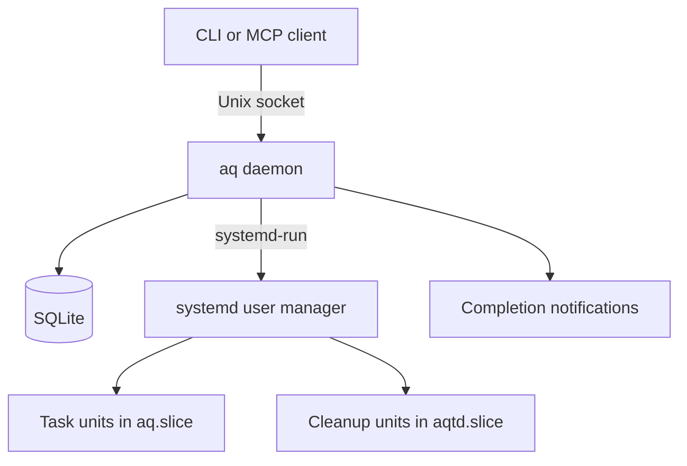

# How aq works

Aq coordinates heavy work on one Linux machine. This page explains what happens
between submitting a command and collecting its result, and where to look if
you want to change that behavior. For commands and setup, use the
[user guide](guide.md).

## Why there is a daemon

Imagine three agents checking available memory at the same moment. Each sees
8 GiB free and starts a 4 GiB job. Their individual checks were reasonable,
but together they promised more memory than the machine had.

Aq puts that decision in one place. Its daemon checks available resources and
reserves them under a scheduler lock. Other submissions see the updated total.
The queue handles waiting; Linux enforces the limits once a job starts.

This assumes cooperative clients under one Unix account. Aq cannot stop another
process with the same permissions from starting work outside the queue.

## The pieces

One Go binary supplies the command-line client, daemon, and MCP server.
The daemon runs as the user service `aq.service`. Clients reach it through a
private Unix socket; the server checks that they belong to the same Unix user.
SQLite stores tasks, reservations, results, profile history, and notification events.

The daemon lives outside the task pool. Each running task has its own systemd
service, so restarting the daemon does not stop the task. Cleanup scripts also
have a separate slice: freeing resources must remain possible when the task
pool is full.

The default locations are:

| What | Location |
|---|---|
| Configuration | `~/.config/agent-queue/config.toml` |
| Database and job files | `~/.local/state/agent-queue/` |
| Client socket | `$XDG_RUNTIME_DIR/agent-queue/aq.sock` |
| Panel snapshot (`aq dashboard`) | `$XDG_RUNTIME_DIR/agent-queue/dashboard.json` |

`AQ_CONFIG`, `AQ_STATE_DIR`, and `AQ_RUNTIME_DIR` override these locations.
Startup locks prevent two daemons from managing the same runtime directory or slice.

## Follow a task

1. **Submit.** The client validates the command, captures selected environment
   variables, and sends the request. The daemon records the task and returns its ID.
2. **Wait for room.** The scheduler checks the pool and the live state of the host.
   A task that cannot start stays queued with a reason visible in `aq status`.
3. **Start with limits.** The daemon asks systemd to create a transient service.
   It sets the memory limit, disables task swap, applies a CPU quota, and sets a
   runtime timeout. It checks the applied memory limit after launch; a mismatch
   stops the unit and produces `LAUNCH_FAILED`.
4. **Run and capture output.** The internal runner starts the command in its
   working directory, provides a private temporary directory, and saves stdout
   and stderr. Each log stream has a size cap; excess output is drained and
   discarded. The temporary directory is `<tmp_dir or /tmp>/aq-<uid>-<slice>/<id>` when
   that filesystem is tmpfs or `tmp_dir` is set, so temp files cost task memory
   (tmpfs pages are charged to the unit's cgroup) instead of SSD writes and
   filesystem-journal churn; otherwise it falls back to the state dir. The daemon
   plans the root at start; only a symlinked or foreign-owned `aq-<uid>-<slice>`
   in a shared `/tmp` sends temp dirs to the state dir. A root that cannot be
   made right now (a full `/tmp`) stays planned: the temp gate holds the queue,
   and nothing moves to the SSD. Because `systemd-tmpfiles` may delete an idle
   root and another user may then plant one, the runner re-checks the root at
   every launch (creating only the root, never a missing parent) and fails the
   launch (`LAUNCH_FAILED`) under a planted one.
5. **Record the result.** The unit's `ExecStopPost` action writes `result.json`,
   including systemd's outcome and cgroup memory measurements. This works even
   while the daemon is down. With the `io` controller delegated (units and the
   slice set `IOAccounting=yes`), it also sums the unit's `io.stat` over physical
   disks only: a device without a `/sys/dev/block/M:m/device` link (dm, md,
   loop, zram) either forwards the same bytes to a physical disk or never
   reaches one. Without the controller the bytes are recorded as unknown (NULL),
   not zero, and nothing else changes. After recording, the same action deletes
   the task's temporary directory, so tmpfs pages never outlive the task outside
   any accounting. Removal restores owner write permission on directories a
   task made read-only (never following symlinks); the scheduler and retention
   use the same routine as fallbacks. Every removal and sweep first opens the
   temp root as a file descriptor through its parent and checks it is a real
   directory owned by the user and writable by no one else; a root replaced by
   a symlink or a foreign directory is left alone, so cleanup can never reach
   files the link points at.
6. **Release resources.** The scheduler waits for the cgroup to become empty
   before finalizing the task and returning its resources to the pool.

Commands are argument arrays, with no implicit shell or variable expansion.
The runner receives `AQ_CPUS` and `AQ_JOB_ID`, along with the captured environment.
Cancellation stops the whole cgroup: SIGTERM first, then SIGKILL after the grace
period. Background descendants do not escape cleanup just by detaching.

Failure reasons distinguish a command error, timeout, launch failure, missing
result, and memory kill. Exit code 137 alone is not evidence of an OOM; aq uses
systemd and cgroup information to classify the outcome.

## How the scheduler decides what fits

A task has two memory values:

- **Limit:** the most memory its cgroup may use.
- **Expected:** the amount reserved when deciding whether it can start.

By default they are equal. A profile or explicit `--expected` can make the
expected amount smaller. For example, a job that usually uses 1 GiB may need a
2 GiB ceiling for short peaks. Accounting for its usual use allows more work
to run, but simultaneous peaks can still cause a task to be killed.

The scheduler checks these blockers in order:

| Blocker | Why the task waits |
|---|---|
| `recovering` | The daemon is still reconciling saved state with systemd. |
| `pressure` | Sustained memory pressure has paused new admissions. |
| `disk` | The state directory has too little free space. |
| `tmp` | The temp dirs' filesystem (tmpfs) has too little free space or too few inodes. |
| `pool_memory` | Existing commitments plus this request exceed the memory pool. |
| `pool_cpu` | Existing commitments plus this request exceed the CPU pool. |
| `live_memory` | The host cannot cover the request and its reserved headroom. |

Every item a pass leaves queued gets a reason, not only the head: the head's
blocker while a gate (`recovering`, `pressure`, `disk`, `tmp`) is closed,
otherwise the item's own blocker against what the pass left, otherwise `queue`:
it would fit now, but starting it would delay the head (see backfill below).
`submit` and `reserve` answer after the nearest pass, so their reply already
says whether the item started and, if not, why.

A reservation with a name is charged like a task with a profile: its stand
(`expected`) and task budget (`task_expected`) come from the recorded peaks of
earlier reservations of that `<repo root>:<name>`, × `limit_margin`, never more
than declared. The declarations stay the ceilings: nested tasks are admitted
within `task_memory`, and `stand_over_declared` compares with `--memory`.

A granted reservation with a docker project that runs no nested task and has
no container for `idle_after` gets one `reservation_idle` event per idle
stretch (in memory: a daemon restart starts the stretch again).

The live-memory check also subtracts memory already promised but not yet used.
Otherwise a newly started job could look cheap before it has allocated its data,
and a second job could be given the same memory.

Tasks and reservations share a queue, ordered by priority and then creation time.
A pass runs on relevant changes and at least once a second. Impossible requests
are rejected rather than left waiting forever.

### Letting smaller jobs use spare capacity

With backfill enabled, a later job can pass a blocked job if it fits now and is
predicted to finish before the blocked job could start, or fits in capacity the
blocked job will not need. This reduces idle time while a large job waits.

Reservations use the spare-capacity rule only: their cleanup time depends on
extensions, nested jobs, and available cleanup slots. Recovery, disk, temp-space
and pressure gates prevent backfill. Forecasts are estimates, so actual starts can be later.

### Protecting the host while jobs run

Checking at launch is not enough: running jobs and unrelated applications can
grow. The host guard regularly lowers the task slice's memory ceiling when
available memory approaches the configured reserve. When its ceiling makes the
kernel OOM in the slice (the slice's own `memory.events.local`, so a task's own
limit does not count), it records a `guard_engaged` incident naming who held
memory (largest cgroups and
processes, memory in no cgroup), at most every 5 minutes: the shortage usually
comes from outside aq and is gone before anyone looks. The dashboard reports
the guard as cutting only when its ceiling falls below the tasks' expected memory
plus the reservations' task budgets: a ceiling below the pool alone is the
guard's normal state when the pool is close to the host's memory. Task and pool limits help
contain memory exhaustion, but they are not a guarantee against every host OOM.

The pressure gate serves a different purpose: it pauses new work when Linux
reports sustained memory stalls, then reopens after pressure subsides. It does
not itself kill running work. Cleanup units remain outside the guarded task slice.

## Why containers need reservations

A Docker container started by a test runs under Docker's cgroup, outside the
test's own memory limit. Submitting the test alone would leave that load unaccounted for.

A reservation holds two separate budgets: one for the external environment,
and optionally one for tasks that use it. Both count against the pool. Tasks
submitted with `--within` use the reserved task budget rather than joining the
main queue again. This avoids two agents each holding an environment while both
wait for enough resources to run their tests.

Aq can measure a named Compose project's memory. Without a fresh measurement,
it conservatively keeps the full declared environment memory counted as unused.
Elapsed time is never treated as proof that reserved memory has been allocated.
Reservations account for external load; they do not impose cgroup limits on Docker.

Every reservation has a lifetime and a saved cleanup script. The script must be
self-contained and safe to run again. On expiry, aq runs it in the cleanup slice.
If nested tasks are still running, cleanup waits for them and new nested
submissions are refused. A failed or missing cleanup result keeps the reservation
counted until an operator retries cleanup or explicitly releases it after manual cleanup.

The death of an agent session does not currently trigger cleanup. The lifetime
remains the fallback. See the [reservation guide](guide.md#reservations) for examples.

## Learning from previous runs

A stable task name identifies a profile, normally scoped to the main repository
root so Git worktrees share history. Aq samples memory during the run and records
its peak, duration, and outcome.

By default, the last ten usable runs supply three estimates:

- A memory limit based on the largest peak, plus a 20% margin.
- Expected memory based on the 90th percentile of memory samples.
- Duration based on the 90th percentile of run durations.

Successful runs and ordinary command failures with measurements are usable.
OOMs, timeouts, and cancellations are excluded. Aq does not automatically raise
a limit after an OOM, and an explicit memory limit always takes precedence.

`aq estimate` simulates admission using the latest scheduler snapshot without
creating a task. It reports a blocker and, when possible, a predicted start.
Profiles measure memory and duration; they do not currently sample task CPU use.

## Getting results back to agents

A state change and its notification event are saved in the same database
transaction. Delivery happens afterward, so a slow notification channel does
not hold up scheduling. Failed deliveries retry with backoff until their deadline.

There are three delivery paths:

| Path | How it works |
|---|---|
| Push | The daemon runs the configured command to wake an agent session. |
| Client wait | The agent harness resumes the session when a background `aq wait` finishes. |
| Operator webhook | The daemon posts alerts to a configured HTTP endpoint, as its own JSON or as a Gong request for Telegram. |

A crash after delivery but before recording success can cause a duplicate with
the same event ID. `aq ack` records that the agent handled an event; it is separate
from delivery. MCP provides tools, but cannot by itself wake an idle session.

The optional command hook only reminds agents about heavy work outside aq.
It never contacts the daemon or blocks a command, and its matching is heuristic.

## Restarts and stored data

On startup, aq compares unfinished database records with systemd units and saved
result files. It adopts live jobs, collects completed results, and stops orphaned
units bearing its managed prefixes. New admissions stay closed until recovery
succeeds. A recovery error causes the daemon to exit rather than schedule against
unreconciled state.

Running tasks, queued work, reservations, and pending notifications survive a
daemon restart. Client connections do not, but `aq wait` treats a refused socket,
a dropped connection or an `UNAVAILABLE` answer (the daemon is shutting down) as
a restart and reconnects with backoff for up to 10 minutes; `aq logs --follow`
does not. On a clean stop the daemon saves the run samples of running tasks and
the host-guard history in `runtime_state` and restores them after recovery; a
crash loses them, which can affect profile data and the classification of a
memory kill around it. Every restart is recorded as an operator event
`daemon_restarted` with the version, whether the stop was clean and what was
picked up.

`aq top` separates physical memory use from scheduler commitments. These answer
different questions—what is using RAM now, and what has been promised—and must
not be added together. `aq stats` summarizes recorded work and host samples.

Disk writes are accounted in two levels. Every host sample, the accountant in
`internal/diskacct` diffs the physical-disk counter and the per-source counters
(aq slice, docker projects, system and user units, login sessions) and keeps the
deltas as hourly sums in the `disk_writes` table. Level one (sources) adds up to
the host figure. Level two (agents) is a per-process estimate from
`/proc/PID/io` inside a source, over each agent and its descendants in the
agent's cgroup (a process once seen in the tree stays with it while it lives, through reads that fail for a few samples); it is stored with the source it lived in and
never added to a sum. Counters are diffed per physical disk and per cgroup: a
disk that goes away adds nothing, a counter that went backwards belongs to a
cgroup re-created under the same path and counts from zero, and a cgroup missing
from a few samples (a failed read) continues from its last counter. Parents are
read raw and their known children subtracted in the accountant, so the tail of
the cgroups that ended between samples lands in `<parent>:ended`. `other` is not
stored per sample: io.stat counts a request when it is issued and the disk
counter when it completes, and a missed cgroup's writes show in `ended` first and
are taken back later, so a per-sample remainder would be noisy and sometimes
negative; the report computes it over the period as the host total minus the
named sources. The alarm is a small state machine over the same
deltas (rate over a window, one event per episode, an all-clear when the window average
falls below half the threshold) and emits `disk_writes_high`/`disk_writes_normal` through the
usual event delivery.

Operator events for temporary storage, swap and sessions use the same delivery path.

| Open event | All-clear event |
|---|---|
| `tmp_full` | `tmp_full_normal` |
| `swap_full` | `swap_full_normal` |
| `sessions_heavy` | `sessions_heavy_normal` |
| `sessions_idle` | `sessions_idle_normal` |
| `tmp_orphans` | `tmp_orphans_normal` |

The host sampler enriches the session inventory from that same process scan
with the session files of Claude Code (`~/.claude/sessions`) and OpenClaude
(`~/.openclaude/sessions`) whose PID and process start time match the sample; a
file without `procStart` (OpenClaude) is verified by `startedAt` against the
process start time (boot time plus start ticks) and must not be older than the
process by more than a minute. OpenCode (`opencode`, in the default
`stats.agent_processes`) keeps no session file, so its rows carry no session
id, status or idle time: they are named by PID, `sessions_idle` cannot count
them, while their memory does count toward `sessions_heavy`. One shared
background service runs the tools of all OpenCode sessions; the scan groups
every process under the topmost agent in its ancestry, so the service is one
row with everything it started and each terminal app outside another agent is
a row of its own. `opencode-pty` is not an agent (the match is exact) and is
part of the service row while it is its child.
The process scan captures start time before reading process details
and verifies it after reading memory and cwd. It drops changed identities
before grouping processes into sessions. Successful samples replace the
published inventory. After a failed process scan, the dashboard keeps the
last session inventory and the session alarms record a missing measurement.
Each `top` response enriches sessions from its own physical memory scan.

Command identity is resolved on the client side (`client.Parent`): aq looks
for the nearest process named in `stats.agent_processes` among its own
ancestors. With an agent found, its own identity variable (one that is absent
from the agent's exec-time environment or differs from the value there) wins,
then the agent's verified session file, then `cli`. With no agent among the
ancestors the environment rules apply as before; `AQ_NO_PARENT_SESSION`
disables the lookup. For OpenCode the nearest agent is its shared service
(`opencode-pty` between them is skipped) and the variable is
`OPENCODE_SESSION_ID`, which OpenCode exports to every tool shell and the
service did not have at start; a subagent's shell carries the subagent's own
id, so its tasks belong to the subagent's session. With no session file, a
command without the variable is `cli`, never a session of another agent. The
process name and the `opencode` adapter (`identity_env =
"OPENCODE_SESSION_ID"`, `client-wait`) are both in the defaults, and that
needs both. Without the process name the environment rules decide, so an
identity variable the service inherited from an outer agent can file an
OpenCode command under that agent's session, or make it ambiguous (exit 64);
without the adapter such a command is `cli` even with the variable, and an MCP
call that relies on the metadata below is refused with `session identity
unknown`.

A CLI command resolves its identity once, when it starts; each MCP call
resolves its own. The `aq mcp` process is started by the agent harness and
does not always carry a session: Codex filters its environment, and OpenCode
starts it from its shared service, which has no session of its own. OpenCode
names the session a call is made for in the request (`tools/call` params
`_meta["ai.opencode/sessionID"]`). For `queue_submit`, `queue_reserve` and
`queue_list` with `mine`, `aq mcp` takes that session when the config holds
exactly one adapter with `OPENCODE_SESSION_ID` — the rule of a session file:
two adapters on one variable give none. The precedence is explicit arguments,
then the call's metadata, then the process: with usable metadata there is no
process lookup, the metadata loses only to explicit arguments, and a `client`
that names another adapter needs an explicit `session_id`, because that
adapter's variable in the environment of `aq mcp` may be one the OpenCode
service inherited from an outer agent. Calls without the metadata are resolved
as before. aq does not verify the metadata: it is routing information of the
same trust as an explicit `session_id`, and if OpenCode leaves it out or
changes its key, the tools answer `session identity unknown` until the
arguments name the session.

A separate loop inventories `/tmp` for the daemon's UID. The socket's `tmp`
operation returns the report and current filesystem usage of its scan root.
With `{"rescan": true}`, requests first join any running pass. With no pass
running, they reuse a report under one minute old or start a new pass.
The `top` response carries both task temp and scan-root filesystem usage and
reports whether their device IDs match. Both `top` and the dashboard carry
active alert episodes. Level alarms use the configured sample interval to
determine how many readings are needed. Only complete scheduled passes
update the orphan alarm. The daemon keeps the latest successful report in memory,
including the total number of partial items and whether all items stayed within
the scan time budget. Unreadable subtrees contribute partial items without
pausing the alarm. If the scan cannot enumerate or search `claude-<uid>`, it
reports that directory as one partial item and continues the inventory.
The loop logs one warning per scan still running after two scan intervals.
On shutdown the loop waits up to five seconds for an in-flight scan. A scan
that returns after cancellation skips report and alarm updates.

Retention removes old logs and history while preserving active items, including
reservations whose cleanup failed. Defaults and controls are in the
[configuration example](../deploy/config.example.toml).

## Design choices and boundaries

Systemd owns process lifetimes and cgroup enforcement; SQLite keeps state and
events together without another service. A pure Go SQLite implementation avoids
a CGO dependency. Scheduling decisions are separated from Linux I/O so they can
be tested with fake clocks, metrics, and executors.

The current scope is one Linux machine and one user account. There is no
preemption, checkpointing, automatic retry of failed jobs, or automatic tracking
of arbitrary containers. Low-priority jobs do not gain priority as they wait.

Some operational limits matter when debugging:

- Docker measurement failures fall back to conservative accounting without a
  dedicated doctor check. Cleanup-owner session liveness is not tracked.
- Environment values can briefly appear in the launch command line. Removing
  them from database rows does not guarantee erasure from SQLite pages or WAL.
- A host-metric read failure can end a scheduling pass without an
  `admission_closed` alert. Doctor does not check the cleanup slice, and an old
  webhook failure can remain visible after delivery recovers.
- Hook statistics are approximate: concurrent log rotation is not locked.
  The hook can also match command-like text inside quoted strings.
- `queue_logs` includes log text in both text and structured output. A flag
  value that is literally `--` is interpreted as the end of flags.
- Executor capabilities exist in code but are not yet used by scheduling policy
  or reported by doctor. `RECOVERING` and `STORAGE_FULL` exist in the model but
  currently have no producing code path.

## Where to find the code

| Path | Contents |
|---|---|
| `cmd/aq` | entry point: `_exec`/`_record-result` to the runner, everything else to the CLI |
| `internal/admission` | pure admission: blocker order, EASY backfill and forecasts, PSI gate, guard ceiling |
| `internal/scheduler` | mutex-guarded queue: submit, passes, launch, reaping, cancel, reservations, teardown, recovery, estimates, profile sampling |
| `internal/store` | SQLite store and migrations: items, outbox, profile runs, samples, retention and export queries |
| `internal/platform` | OS-facing interfaces (`Executor`, `HostMetrics`, meters, OOM log) |
| `internal/platform/linux` | systemd/cgroup executor, procfs host metrics, Docker stand meter, usage meter, systemd-oomd journal reader |
| `internal/platform/fake` | goroutine-safe fake platform for tests |
| `internal/runner` | in-unit supervisor (`aq _exec`) and result recorder (`aq _record-result`) |
| `internal/daemon` | wiring and locks, request handlers, host guard, samplers, incidents, retention, `top`/`stats` views |
| `internal/protocol` | versioned newline-delimited JSON over the Unix socket, client and server |
| `internal/notify` | routing, outbox lanes with retries, push (exec) and webhook delivery, message text |
| `internal/client` | request building shared by CLI and MCP, environment capture, identity, profile and project detection |
| `internal/cli` | commands, help, plain and pretty output, exit codes, `aq doctor` |
| `internal/mcp` | stdio MCP server and tools |
| `internal/hook` | PreToolUse reminder and hit counter |
| `internal/profile` | usable runs, histogram, percentile estimates, name validation |
| `internal/stats` | pure summaries for `aq stats` |
| `internal/model` | items, states, reasons, priorities, events |
| `internal/config` | loading, defaults, validation, paths |
| `internal/units` | sizes and durations |
| `deploy/` | systemd units, example config, hook fragments, agent skills |
| `test/e2e` | end-to-end tests against the real user manager in separate slices |
